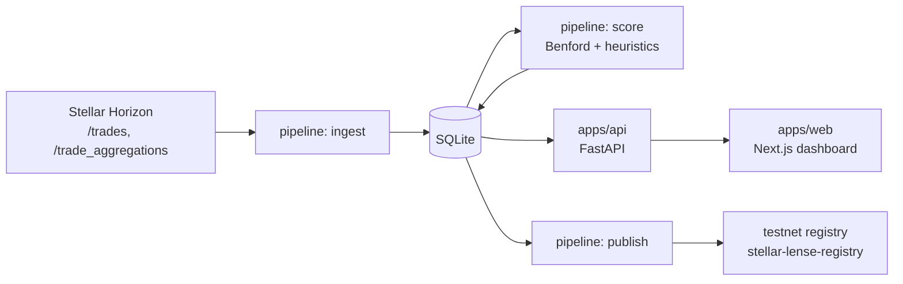

# Stellar Lense

[](LICENSE)
[](https://github.com/Stellar-lens/Stellar-Lense/actions/workflows/ci.yml)
[](https://stellar.org)

**Wash-trading risk scores for the Stellar DEX.**

Stellar Lense scores wallets trading on the Stellar DEX (SDEX) for wash-trading
risk: two or more accounts trading the same asset back and forth to fake volume.
Each score combines Benford's Law analysis of trade amounts with a few
transparent trade-pattern signals (counterparty concentration, round trips,
self-matching, tight timing). Scores are served by a REST API and shown on a
web dashboard; a Soroban contract for publishing them on-chain is in progress.

## Status

What works today, and what doesn't. Nothing in this table is aspirational.

| Component | Status | Notes |
|---|---|---|
| Horizon ingestion (`packages/core/pipeline`) | ✅ working | Pulls recent trades and 24h market data for 14 liquid mainnet SDEX pairs into SQLite. Read-only. |
| Benford + heuristic scoring (`packages/core`) | ✅ working | Scores every wallet with ≥ 5 trades in the last 24h. Weights are fixed and documented below. |
| REST API (`apps/api`) | ✅ live data | Serves the latest scoring run, its history and market data. Every response says how the score was made. Synthetic demo data only with `DEMO_MODE=1`. |
| Dashboard (`apps/web`) | ✅ live data | Risk ranking with real price / 24h change / volume, per-pair drill-down, alerts, "data as of" label; a banner in demo mode. |
| Evaluation | 🟡 not yet meaningful | A reproducible script and report exist, but public on-chain data yielded only 28 labelled wallets (1 positive), so the precision/recall it reports say nothing yet. See [the report](packages/core/evaluation/REPORT.md). |
| Optional ML model | 🟡 synthetic only | `packages/core/scripts/train_model.py` trains a random forest on synthetic data. Off by default; labelled as synthetic when on. |
| Soroban risk-score registry (`contracts/soroban`) | ✅ on testnet | Contract `CC4SWEQBSIY7OFBBY37TZGJVDETMDIG5DVYGHPTEWJO2Q6BJK3V5EEQG` (Wasm `a71f4a018e862594…`, see [`deployments/testnet.json`](deployments/testnet.json)). The pipeline publishes each scoring run when `REGISTRY_CONTRACT_ID`/`PUBLISHER_SECRET` are set; a nightly job reads scores back. Example gated AMM: `CA2IDVGG66MSBIVXKTONRQP6FRRIHIBZBOGCHUGGYQLIIWIANC3ALE6P`. Not on mainnet. |
| Validation against confirmed wash-trading cases | ⬜ not built | No confirmed real-world labels exist yet. |

## How it fits together



| Directory | What it is |
|---|---|
| [`packages/core`](packages/core) | Python detection engine (Horizon loader, Benford statistics, features, `score_wallet`) and the `pipeline` that ingests and scores on a schedule. |
| [`apps/api`](apps/api) | FastAPI service: `/meta`, `/market`, `/score/{wallet}/{pair}`, `/assets/risk-ranking`, `/assets/{pair}/scores`, `/assets/{pair}/score-history`, `/alerts/recent`. |
| [`apps/web`](apps/web) | Next.js dashboard: risk ranking, per-pair drill-down, alerts, news feed. |
| [`contracts/soroban`](contracts/soroban) | Rust/Soroban risk-score registry contract. |
| [`docs`](docs) | Design system and project plan. |

## How a score is computed

For one wallet on one asset pair, over that wallet's trades:

| Signal | Weight | Meaning |
|---|---|---|
| Counterparty concentration | 25 | Share of volume traded with the single largest counterparty. |
| Round-trip frequency | 25 | Share of trades reversed (same two assets, opposite direction) within the next 5 trades. |
| Self-matching rate | 20 | Share of trades where buyer and seller are the same account. |
| Intra-minute clustering | 10 | Share of trades sharing a calendar minute with another trade. |
| Off-hours activity | 5 | Share of trades between 00:00 and 06:00 UTC. |
| Benford MAD | up to 15 | Deviation of first digits from Benford's Law; only used with ≥ 30 trades. |

The score is the weighted sum, clamped to 0–100. These weights are hand-set,
not learned, and have not been validated against confirmed real-world
wash-trading cases (the evaluation report explains why that hasn't been
possible yet).
Self-matching is always zero on the SDEX, where the protocol won't let an
account fill its own offer (0 of 81,268 trades in a 24h sample), so the
highest score reachable on SDEX data is 80.

## Quick start

Requires Docker. The first scoring run takes a few minutes (the busiest
pairs have tens of thousands of trades a day); the dashboard comes up when
it completes.

```bash
git clone https://github.com/Stellar-lens/Stellar-Lense.git && cd Stellar-Lense
docker compose up --build
open http://localhost:3000   # API at http://localhost:8000/docs
```

`DEMO_MODE=1 docker compose up` serves hard-coded synthetic data instead.
To run the pieces without Docker:

```bash
uv sync --all-packages && pnpm install
(cd packages/core && DB_PATH=../../data/stellar_lense.db uv run python -m pipeline run)
(cd apps/api && DB_PATH=../../data/stellar_lense.db uv run uvicorn api.main:app) &
pnpm --filter @stellar-lense/web dev
```

## Development

```bash
make lint-all   # eslint, ruff, cargo fmt + clippy
make test-all   # pytest (core + api), cargo test
```

CI runs exactly these two targets on every pull request.

## History

This repository was consolidated from several earlier repositories. Code that
nothing in the product called (federated learning, ZK proofs, GNNs, causal
inference, cross-chain loaders, a second API, a trading bot, placeholder
packages and a third copy of the detection pipeline) was removed from `main`
and is preserved unchanged on the
[`archive/pre-consolidation`](https://github.com/Stellar-lens/Stellar-Lense/tree/archive/pre-consolidation)
branch.

## License

MIT, see [`LICENSE`](LICENSE).
