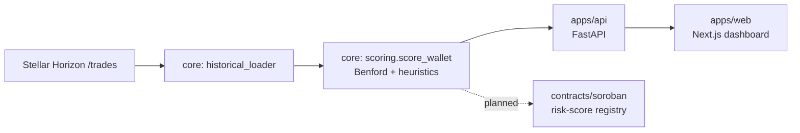

# Stellar Lense

[](LICENSE)
[](https://github.com/Stellar-lens/Stellar-Lense/actions/workflows/ci.yml)
[](https://stellar.org)

**Wash-trading risk scores for the Stellar DEX.**

Stellar Lense scores wallets trading on the Stellar DEX (SDEX) for wash-trading
risk: two or more accounts trading the same asset back and forth to fake volume.
Each score combines Benford's Law analysis of trade amounts with a few
transparent trade-pattern signals (counterparty concentration, round trips,
self-matching, tight timing). Scores are served by a REST API and shown on a
web dashboard; a Soroban contract for publishing them on-chain is in progress.

## Status

What works today, and what doesn't. Nothing in this table is aspirational.

| Component | Status | Notes |
|---|---|---|
| Benford + heuristic scoring engine (`packages/core`) | ✅ working | Tested (`make test-py`). Weights and thresholds are fixed and documented in `detection/scoring.py`. |
| Horizon trade loader (`packages/core/ingestion`) | ✅ working | Pages Horizon `/trades` for a pair. Not yet run on a schedule or wired to the API. |
| REST API (`apps/api`) | 🟡 demo data | Serves scores from 12 hard-coded synthetic trades. Every score says how it was made (`method: heuristic` or `ml`). |
| Dashboard (`apps/web`) | 🟡 demo data | Shows the API's demo scores. Price / 24h / volume columns are placeholders. |
| Optional ML model | 🟡 synthetic only | `packages/core/scripts/train_model.py` trains a random forest on synthetic data. It is off unless you build it, and labelled as synthetic when on. |
| Soroban risk-score contract (`contracts/soroban`) | 🟡 builds and tests | Not deployed; nothing writes to it yet. |
| Evaluation on labelled real-world cases | ⬜ not built | No precision/recall numbers exist yet. |

## How it fits together



| Directory | What it is |
|---|---|
| [`packages/core`](packages/core) | Python detection engine: Horizon loader, Benford statistics, features, `score_wallet`. |
| [`apps/api`](apps/api) | FastAPI service: `/score/{wallet}/{pair}`, `/assets/risk-ranking`, `/assets/{pair}/scores`, `/assets/{pair}/score-history`, `/alerts/recent`. |
| [`apps/web`](apps/web) | Next.js dashboard: risk ranking, per-pair drill-down, alerts, news feed. |
| [`contracts/soroban`](contracts/soroban) | Rust/Soroban risk-score registry contract. |
| [`docs`](docs) | Design system and project plan. |

## How a score is computed

For one wallet on one asset pair, over that wallet's trades:

| Signal | Weight | Meaning |
|---|---|---|
| Counterparty concentration | 25 | Share of volume traded with the single largest counterparty. |
| Round-trip frequency | 25 | Share of trades reversed (same two assets, opposite direction) within the next 5 trades. |
| Self-matching rate | 20 | Share of trades where buyer and seller are the same account. |
| Intra-minute clustering | 10 | Share of trades sharing a calendar minute with another trade. |
| Off-hours activity | 5 | Share of trades between 00:00 and 06:00 UTC. |
| Benford MAD | up to 15 | Deviation of first digits from Benford's Law; only used with ≥ 30 trades. |

The score is the weighted sum, clamped to 0–100. These weights are hand-set,
not learned, and have not yet been validated against confirmed real-world
wash-trading cases.

## Quick start

Requires [uv](https://docs.astral.sh/uv/), Node 22 and pnpm 9.

```bash
pnpm install && uv sync --all-packages
(cd apps/api && uv run uvicorn api.main:app --port 8000) &
pnpm --filter @stellar-lense/web dev   # http://localhost:3000
```

## Development

```bash
make lint-all   # eslint, ruff, cargo fmt + clippy
make test-all   # pytest (core + api), cargo test
```

CI runs exactly these two targets on every pull request.

## History

This repository was consolidated from several earlier repositories. Code that
nothing in the product called (federated learning, ZK proofs, GNNs, causal
inference, cross-chain loaders, a second API, a trading bot, placeholder
packages and a third copy of the detection pipeline) was removed from `main`
and is preserved unchanged on the
[`archive/pre-consolidation`](https://github.com/Stellar-lens/Stellar-Lense/tree/archive/pre-consolidation)
branch.

## License

MIT, see [`LICENSE`](LICENSE).
